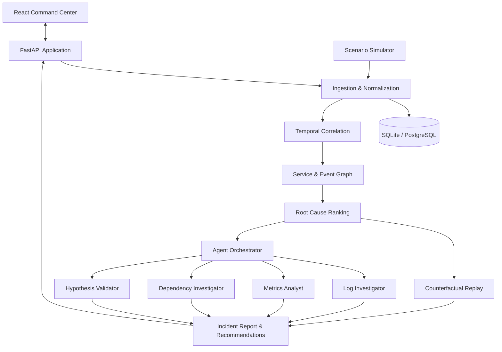

# 02 — System Architecture

## 1. Architecture principle

Build a **modular monolith first**: one FastAPI backend with clearly separated modules and one React frontend. The architecture should be easy to run, debug and vibe-code under hackathon time constraints. Do not introduce distributed infrastructure before the end-to-end MVP works.

## 2. High-level architecture



## 3. Runtime components

### Frontend
- Command Center: current system health, active incidents, event feed.
- Incident Workspace: timeline, causal graph, root-cause candidates, evidence.
- Investigation Panel: agent status, findings and evidence-linked answer.
- Counterfactual Lab: choose a hypothesis, run replay, compare outcomes.
- Scenario Lab: select, inject, pause, reset and recover scenarios.

### Backend modules
- `api`: routes, request/response schemas and SSE endpoints.
- `ingestion`: event validation, normalization and deduplication.
- `scenarios`: scenario definitions and deterministic event generator.
- `correlation`: incident windowing and event grouping.
- `topology`: service dependency model and graph utilities.
- `causal`: feature extraction, hypothesis scoring and explanation.
- `counterfactual`: model-based intervention and replay.
- `agents`: orchestration, prompts, tools and provider adapter.
- `reports`: incident report assembly and export.
- `persistence`: repository interfaces and database models.

### Storage
Use SQLite initially for frictionless local setup. Keep SQLAlchemy models and repository interfaces compatible with PostgreSQL. Store raw events, normalized events, services, dependencies, incidents, hypotheses, agent runs and reports.

### Live updates
Use Server-Sent Events for event feed and incident status. Use ordinary REST for commands and queries. SSE is simpler than WebSockets for a mostly server-to-browser stream.

## 4. End-to-end data flow

1. Scenario simulator emits an event.
2. Ingestion validates and normalizes it.
3. Event is persisted and published to the in-process event bus.
4. Correlation module updates active incident candidates.
5. Topology module maps event service to dependency graph.
6. Causal module updates candidate features and scores.
7. Incident workspace is updated through SSE.
8. When requested, agent orchestrator runs read-only investigation tools.
9. Counterfactual module replays the scenario model with an intervention.
10. Report builder combines deterministic findings and agent explanation.

## 5. Recommended repository structure

```text
jarvis/
  README.md
  .env.example
  docker-compose.yml                 # optional
  frontend/
    src/
      app/
      components/
      features/
        dashboard/
        incidents/
        topology/
        investigation/
        counterfactual/
        scenarios/
      lib/
      types/
  backend/
    app/
      main.py
      api/
      core/
      models/
      schemas/
      persistence/
      ingestion/
      scenarios/
      correlation/
      topology/
      causal/
      counterfactual/
      agents/
      reports/
      tests/
    requirements.txt
  data/
    scenarios/
    sample_events/
  docs/
```

## 6. API / module boundaries

- API layer validates inputs and calls application services.
- Domain modules must not depend on FastAPI request objects.
- Causal engine must be callable without an LLM.
- Agents may call only registered tools; no arbitrary shell, SQL or network access.
- Frontend must consume typed API responses, not embed analysis logic.
- Scenario simulator must be deterministic when given a fixed seed.

## 7. Key architecture decisions

| Decision | MVP choice | Reason |
|---|---|---|
| Backend | FastAPI | Fast Python iteration and analysis ecosystem |
| Frontend | React + TypeScript | Strong interactive dashboard ecosystem |
| Graph | NetworkX in backend, React Flow in UI | Avoid graph database setup |
| Database | SQLite first | Easy local setup; PostgreSQL upgrade path |
| Streaming | SSE | Simple one-way live updates |
| Events | In-process event bus | Enough for single-process prototype |
| AI | Provider adapter + deterministic fallback | Demo must work offline |
| Deployment | Simple local run / optional Docker | Reduce setup risk |

## 8. Future production evolution (not MVP)

If justified after the demo:
- Kafka or Redpanda for high-volume event streaming.
- OpenTelemetry collector integration.
- Neo4j for large persistent topology graphs.
- PostgreSQL for shared deployment.
- Kubernetes and cloud integrations.
- Role-based approvals and audit logs.

Do not claim these are implemented unless they are.
